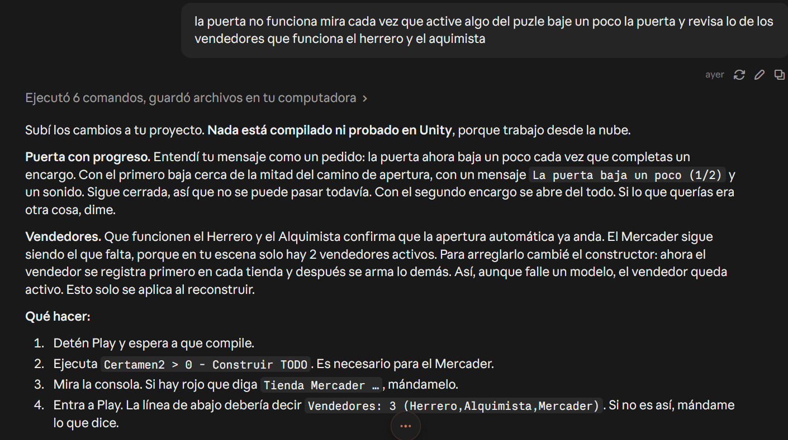
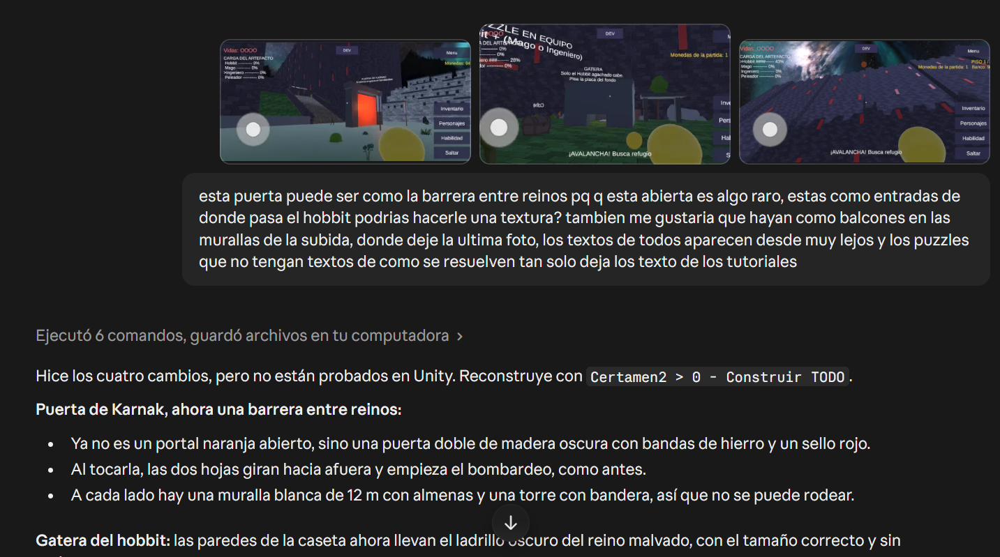
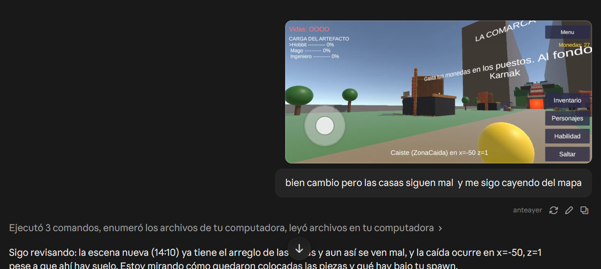

# ASCUA - Entrega del Examen (Meta Quest)

Equipo: [completar]  |  Fecha: [completar]
Repositorio GitHub: [completar]  |  Pagina itch.io: [completar]  |  Teaser: [completar]

---
## 1. Transformacion del APK de telefono al lente Meta Quest
| Tema | Certamen 2 (celular) | Examen (Quest) | Donde esta |
|---|---|---|---|
| Plataforma | Android, IL2CPP, ARM64 | Android + OpenXR (loader) + Meta Quest feature, minSdk 29, espacio de color Linear | Menu `Examen > 2 - Configurar Meta Quest` (`Editor/ExamenTools.cs`) |
| XR | no habia | XR Plug-in Management + OpenXR + Unity OpenXR: Meta; perfil **Oculus Touch**; render **Single Pass Instanced** | idem |
| Entrada | pantalla tactil (joystick y botones en pantalla) | controles: joysticks, A/X/Y/B, grip y gatillos (Input System, rutas `<XRController>`) | `VRRig.cs`, `VRHand` |
| Camara | camara en primera persona que sigue al personaje | la cabeza (HMD) manda: la camara es hija de un "rig" que sigue al personaje; giro por pasos de 30 grados (evita mareo) | `VRRig.PollHead`, `SyncRig` |
| Escala | personajes de 1,7 m, mundo en metros | se mantiene 1 unidad = 1 m; el rig apoya los pies en el suelo del personaje | `VRRig.SyncRig` |
| HUD | Canvas en pantalla | Canvas en **World Space** pegado a la cabeza (1,3 m delante) | `VRRig.SetupHud` |
| Menus (tienda, altar, tutoriales, dialogo) | tactiles | se convierten a World Space delante del jugador y se pulsan apuntando + gatillo | `VRUiBridge.cs` |
| Escena inicial | Menu | **Hall** (escena 0 del build) | `Hall.cs` |

Decision tecnica: el modo VR se activa solo con casco (`XRSettings.isDeviceActive`) o con la opcion "Modo VR" del menu, y el mismo proyecto sigue funcionando en celular/PC. Asi se mantiene una sola base de codigo.

## 2. Lista numerada de funcionalidades e interacciones (con su logica)
1. **Hall de acceso** (`Hall.cs`): plaza de piedra, paneles de historia/controles/objetivo, Ascua flotante y portal. El portal se activa cruzandolo o apuntando + gatillo; guarda `modoVR` y carga la Comarca con la cinematica.
2. **Movimiento y giro VR** (`VRRig`, `Hall`): joystick izquierdo mueve segun hacia donde mira la cabeza; joystick derecho gira 30 grados por toque.
3. **Salto / cambio de personaje / agacharse** (A / X / Y): `PartyManager` deja un solo personaje activo; el nuevo aparece donde estaba el anterior.
4. **Escalada mano sobre mano** (grip sobre `ClimbHold`): se guarda el punto de agarre de cada mano y el cuerpo se mueve por la diferencia al tirar.
5. **Cubos agarrables** (`PuzzleCube`): grip agarra/suelta; al soltar con movimiento se lanza con la velocidad de la mano.
6. **Gancho del Ingeniero** (`AbilityController`, gatillo): rayo de 28 m a cualquier superficie; funciona como impulso, con enfriamiento.
7. **Magia del Mago** (`MagicShooter`/`MagicProjectile`, gatillo o arco a dos manos): proyectil con modelo propio y sonido; rompe bolas de fuego, activa cristales y hiere al jefe. En el arco, la separacion de las manos define la carga.
8. **Palanca** (`Lever`): se acciona apuntando + B; dispara su `LatchRelay`.
9. **Placa de presion** (`WeightPlate`): se activa al pisarla; dispara su `LatchRelay`.
10. **Cristal-objetivo** (`Crystal` + `CrystalLook`): se activa con un disparo magico; levanta el puente o la torre segun el puzzle.
11. **Puente que sube** (`BridgeDeploy`): al activarse el cristal sube desde la lava con animacion suave.
12. **Caseta con gatera baja** (`CoopBuilder.Hut`): solo el Hobbit agachado cabe; adentro hay palanca o placa.
13. **Puerta del piso** (`MountainDoor` + `ActivationCounter`): necesita 2 encargos; baja un poco con cada uno y se abre al completar (checkpoint al otro lado). Panel y boton junto a la puerta muestran `[OK]/[falta]` (`DoorCheck`).
14. **Checkpoints** (`Checkpoint`): cada puerta abierta guarda el punto de reaparicion.
15. **Bolas de fuego y refugios** (`FallingRockSpawner`, `AvalancheDirector`): oleadas calma-aviso-rafaga, sombra roja, explosion en area; refugios en cada terraza.
16. **Corrupcion del Ascua y relevo** (`ArtifactBurden`): quien lo lleva se corrompe; relevo forzado al 100 % y impulso temporal.
17. **Vendedores (3)** (`Vendor`, `NearVendor`, `VendorMenu`): al acercarse se abre la charla; mejoras permanentes con monedas. En VR se usan con el puntero de `VRUiBridge`.
18. **Cofre y altar de reliquias** (`Chest`, `BoonAltar`): eliges 1 de 3 mejoras de partida.
19. **Enemigos** (`Enemy`): zombies con animacion de ataque procedural; dano y empuje.
20. **Jefe Cronarca** (`BossController`): manecillas, bombas de tiempo y rebobinado; se activa al acercarse a la cima.
21. **Sonido**: musica por escena (`MusicPlayer`), viento (`WindAmbience`), zumbido 3D del portal, disparo del mago (mp3), pitidos de retroalimentacion en cada accion (`Sfx`).
22. **Modo desarrollador** (`DevMode`): saltar a pisos/jefe y abrir puertas, para pruebas y para la demostracion.
23. **Medicion y optimizacion** (`PerfProbe`, `QuestPerf`): ver informe de eficiencia.

## 3. Secuencia integrada (cadena de interacciones)
Piso con foso de lava (una de las variantes; la otra usa torre y gancho):
1. El **Hobbit** (X para cambiar de personaje) se **agacha** (Y) y entra por la **gatera** de la caseta. -> *interaccion: agacharse + paso por espacio bajo*.
2. Dentro **tira la palanca** (o pisa la placa). -> `LatchRelay` del encargo del Hobbit queda activado y la puerta **baja un poco** (1/2). -> *interaccion: palanca/placa*.
3. Se cambia al **Mago** (X). Apunta al **cristal** al otro lado de la lava y **dispara** (gatillo, o arco a dos manos). -> *interaccion: cambio de personaje + proyectil + cristal*.
4. El cristal activa el `BridgeDeploy`: el **puente sube** sobre la lava; el equipo cruza y acciona la segunda palanca. -> `LatchRelay` de ayuda activado (2/2). *(Con el Ingeniero: gancho al pilar y cruza volando.)*
5. `ActivationCounter` llega a 2 -> `MountainDoor.Activate`: **la puerta baja**, suena el aviso, se guarda el **checkpoint** y se habilita la rampa al piso siguiente. -> *interaccion: puerta + checkpoint*.
6. Durante todo el piso caen **bolas de fuego**: la magia las rompe y los refugios protegen; el **Ascua** corrompe a quien la lleva, asi que hay que **relevar** de personaje a tiempo. -> *interacciones simultaneas*.
Cadena minima: palanca -> cristal/puente -> contador -> puerta -> checkpoint (5 eslabones encadenados, 8+ interacciones distintas).

## 4. Problemas resueltos (para la explicacion tecnica)
Completar con lo ocurrido en la migracion real al Quest. Problemas ya resueltos en el codigo durante el desarrollo (verificables en el historial de Git / conversaciones):
- Menus tactiles no visibles en VR -> `VRUiBridge` (World Space + puntero).
- Tienda: solo respondian algunos vendedores -> deteccion por cercania con reparacion automatica (`NearVendor.Guarantee`).
- Puertas que no abrian -> la puerta se reconstruye por geometria y se enlaza al contador; boton DEV por piso y panel de encargos.
- El jefe no aparecia -> activacion por distancia como respaldo del trigger.
- [completar: problemas reales de compilar/instalar en el Quest: modo desarrollador, adb, drivers, version de OpenXR, permisos, rendimiento, etc.]

## 5. Evidencia de uso de asistentes de IA
Capturas reales de las conversaciones con el asistente de IA (Claude) durante el desarrollo: cada una muestra lo que se pidio, lo que respondio y como se reviso en Unity.

**Evidencia 1 - Puerta con progreso y vendedores.**

- Pedido: la puerta no funciona; que baje un poco cada vez que se activa algo del puzzle; revisar los vendedores (funcionaban el Herrero y el Alquimista, no el Mercader).
- Respuesta del asistente: la puerta baja una parte con el primer encargo (mensaje "La puerta baja un poco (1/2)" y sonido) y se abre del todo con el segundo. Para el Mercader cambio el constructor: el vendedor se registra primero en cada tienda y despues se arma el resto, asi un modelo que falle ya no deja la tienda sin vendedor. Indico reconstruir con `Certamen2 > 0 - Construir TODO` y revisar la linea de depuracion "Vendedores: 3".
- Revision del equipo: se probo en Unity y se reviso la consola; el problema de los vendedores reaparecio mas tarde y se resolvio con el arreglo de `Modal` descrito en el punto 4.

**Evidencia 2 - Puerta de Karnak como barrera, textura de la gatera, murallas y textos.**

- Pedido: que la puerta abierta sea una barrera entre reinos; textura para las entradas por donde pasa el hobbit; balcones en las murallas de la subida; que los textos no aparezcan desde tan lejos y que los puzzles sin instrucciones dejen solo los textos de tutorial.
- Respuesta del asistente: puerta doble de madera oscura con bandas de hierro y sello rojo que se abre hacia afuera al tocarla; murallas blancas de 12 m con almenas y torres con bandera a cada lado; gatera del hobbit con el ladrillo oscuro del reino, con el tamano correcto.
- Revision del equipo: se reviso en Unity y se pidio reconstruir la escena.

**Evidencia 3 - Casas mal colocadas y caida del mapa.**

- Pedido: las casas seguian mal y el jugador se seguia cayendo del mapa (mensaje "Caiste (ZonaCaida) en x=-50 z=1").
- Respuesta del asistente: reviso la escena nueva, confirmo que ya tenia el arreglo de las casas y que la caida ocurria en x=-50, z=1 aunque ahi habia suelo, y siguio analizando como estaban colocadas las piezas y que habia bajo el punto de aparicion.
- Revision del equipo: se corrigio la orientacion de las casas (`PropModels.DressHut`) y se verifico el recorrido en Unity.

